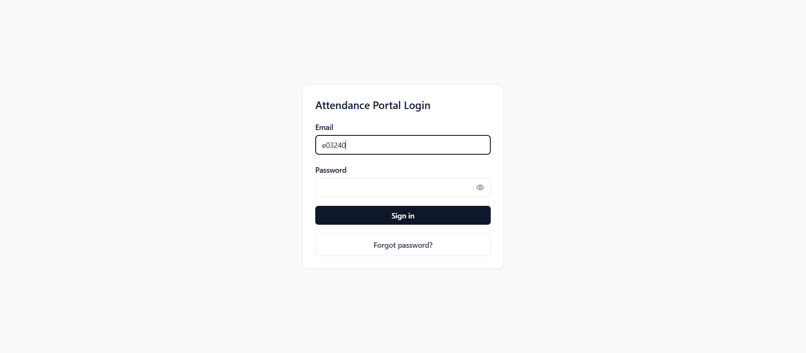
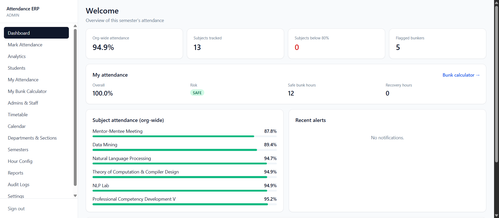
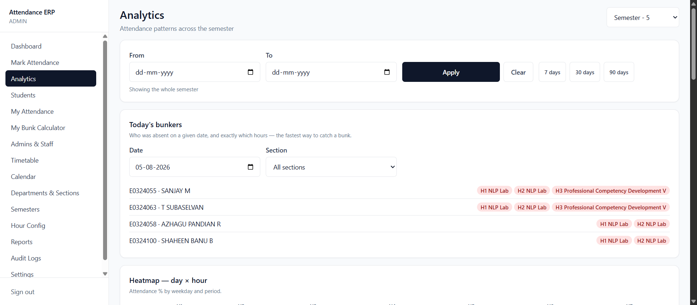
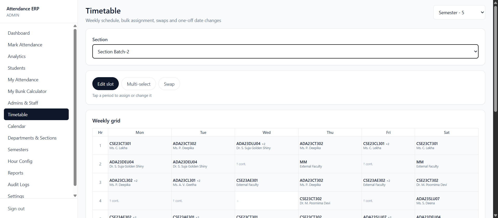
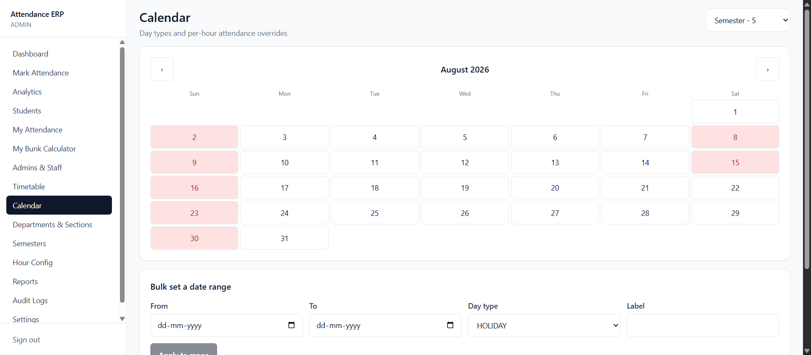
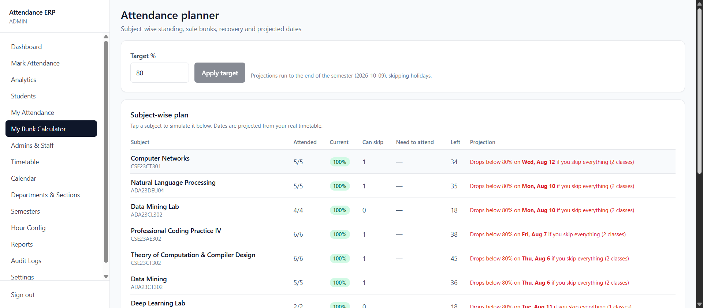

# Attendance ERP

A multi-semester college attendance system built for the edge — Hono on Cloudflare Workers, Next.js on Workers, and D1 (SQLite) for storage. Designed around how attendance actually gets taken: multi-hour labs marked once, exam days that cancel only some periods, one-off room swaps, and a bunk detector that knows the difference between "absent all day" and "left after second period".

## Why this exists

Most attendance trackers assume one semester, one hour per class, and a student who is either present or absent. Real timetables aren't like that:

- A 2-hour lab is **one** class the faculty marks once, but it costs the student **2 hours** of attendance.
- An exam on Tuesday might occupy hours 1–2 while hours 3–7 run normal classes.
- Mentor-mentee meetings are compulsory but shouldn't drag down an academic percentage.
- A student who skipped hour 4 and came back for hour 5 bunked. One who never showed up was absent. Those are different problems.

This system models all of that explicitly rather than approximating it.

---

## Screenshots

| | |
|---|---|
|  Login |  Admin dashboard — org-wide stats + personal attendance |
|  Analytics — heatmap, bunk leaderboard, late analytics |  Timetable builder |
|  Calendar — day types, per-hour overrides |  Bunk calculator with projected crossing dates |

---

## Features

### Attendance marking
- **Mobile-first marking sheet** — pick date, section, hour; tap through the roster
- **Bulk actions** — mark all present/absent, then correct the exceptions
- **Multi-hour blocks** marked once, recorded per covered hour
- **Locking** — freeze a day so records become immutable
- **Mandatory reason on edit**, written to an append-only audit log

### Timetable
- Weekly grid per section with drag-free tap-to-edit
- **Multi-select** to assign one subject across several periods at once
- **Period swap** — exchange two slots, or move one into an empty slot
- **One-off date overrides** — "today hour 3 is Data Mining instead of Networks", or cancel a period entirely, without touching the recurring pattern
- Faculty auto-fills from the subject's usual teacher, still overridable
- Conflict detection catches a faculty member double-booked across sections, including partial overlaps with multi-hour blocks

### Calendar
- Day types: working, holiday, exam, internal exam, event, workshop, industrial visit, sports day, symposium, study holiday, custom
- **Per-hour overrides** for partial days — exam in hours 1–2, classes in 3–7
- Bulk-set a date range, optionally filtered to specific weekdays (e.g. every Sunday)

### Student portal
- **Attendance planner** — per-subject standing with safe-bunk and recovery counts
- **Projected crossing dates** — the exact date you drop below the target if you keep skipping, or climb back if you attend everything, walked from the real timetable with holidays skipped
- **What-if simulator** — scoped to a subject, by count or by specific dates/hours
- Colour-coded timeline, day-of-week and hour-of-day patterns, streaks

### Admin analytics
- **Daily bunkers** — who was absent on a given date and exactly which hours
- **Heatmap** — attendance % by weekday × period
- **Bunk leaderboard** ranked by detected mid-class patterns
- **Late analytics** — worst day, worst hour, repeat offenders
- **Subject report** — hours marked vs scheduled, coverage %, correction count
- Date-range filter across every panel

### Admin
- Departments, sections, subjects, academic years, semesters — full CRUD
- **Semester archive and clone** — copy structure into a new term, leaving attendance behind
- Student CSV import with row-level validation (nothing is written if any row fails)
- Staff management with role changes and deactivation
- Configurable thresholds: minimum %, grace period, late/very-late cutoffs, edit window, auto-lock

### Automation
- Nightly cron recalculates health scores, detects bunk patterns, and raises risk alerts
- Notifications at warning and critical attendance thresholds
- Excel/CSV export generated and streamed on request (no object storage needed)

---

## Architecture

```
attendance-erp/
├── apps/
│   ├── api/          Hono on Cloudflare Workers — REST API, JWT auth, cron
│   └── web/          Next.js 15 App Router on Workers via OpenNext
└── packages/
    └── db/           Prisma schema, migrations, seed scripts
```

**Stack**

| Layer | Choice | Notes |
|---|---|---|
| API | Hono | Edge-native, tiny, runs on workerd |
| Frontend | Next.js 15 + Tailwind | App Router, deployed via `@opennextjs/cloudflare` |
| Data fetching | TanStack Query | Cache, invalidation, optimistic states |
| Auth state | Zustand + `persist` | JWT in localStorage, hydration-aware guard |
| Database | **Cloudflare D1** (SQLite) | Accessed through Prisma's D1 driver adapter |
| Validation | Zod | Every request body and query string |

### Data model

20 models. The ones that carry the domain:

- `Timetable` — weekly recurring slots, with `durationHours` so a lab is one row
- `TimetableOverride` — a single date's deviation; null subject means cancelled
- `CalendarDay` + `HourOverride` — day types and per-period attendance toggles
- `Attendance` — one row per student per hour, unique on `(date, hourNumber, studentId, subjectId)`
- `AuditLog` — old status, new status, reason, who, when
- `BunkFlag`, `HealthScore` — cached nightly analytics

**On enums:** the schema originally targeted PostgreSQL with nine native enums. D1 is SQLite, which has none, so those columns are `TEXT` with allowed values documented inline and exported as TypeScript string unions from `@attendance/db`. Zod validates at the API boundary; the database no longer enforces it. That trade is the main cost of running on D1.

**On transactions:** D1 has no interactive transaction mode, so there are no `$transaction(async tx => …)` callbacks. Batched arrays are used where ordering is enough, nested writes where one record's ID feeds another, and the semester clone runs sequentially with explicit cleanup on failure.

---

## Running locally

**Requirements:** Node 20+, npm, a Cloudflare account for deploys.

```bash
npm install
```

Create `apps/api/.dev.vars`:

```
JWT_SECRET="a-long-random-string"
SMTP_USER="you@gmail.com"
SMTP_PASS="your-gmail-app-password"
```

Then:

```bash
npm run db:generate                # Prisma client
npm run dev:api                    # API on :8787
npm run dev:web                    # Web on :3000
```

The local API entry point (`apps/api/src/dev-server.ts`) runs the Hono app on plain Node so nodemailer and local tooling work; production runs the same app on workerd.

### Seeding

```bash
cd packages/db
DATABASE_URL="file:./dev.db" npx tsx prisma/seed.ts            # users
DATABASE_URL="file:./dev.db" npx tsx prisma/seed-students.ts   # student profiles
DATABASE_URL="file:./dev.db" npx tsx prisma/seed-timetable.ts  # timetable + subjects
```

Every seeded user starts with a shared temporary password and `mustChangePassword: true`, so first login goes through the OTP flow.

---

## Deploying from GitHub (Workers Builds)

Each app is a separate Worker, so the repository connects **twice** — once per
Worker. Connecting a repo is dashboard-only; there is no wrangler command for it.

In **Workers & Pages → \<worker\> → Settings → Builds → Connect**, pick this repo and set:

| Setting | `attendance-erp-api` | `attendance-erp` |
|---|---|---|
| Root directory | `apps/api` | `apps/web` |
| Build command | *(leave empty)* | `npx opennextjs-cloudflare build` |
| Deploy command | `npx wrangler deploy` | `npx opennextjs-cloudflare deploy` |

The Worker name in the dashboard must match `name` in that directory's
`wrangler.toml`, or the build is rejected.

Prisma's client is generated, not committed, so the root `package.json` runs
`db:generate` on `postinstall` — that covers both builds without a custom command.

Secrets are **not** read from the repo. Set them once per Worker with
`wrangler secret put` (below); Workers Builds keeps them across deploys.

## Deploying from your machine

```bash
# 1. Create the database
npx wrangler d1 create attendance-db
#    paste the printed database_id into apps/api/wrangler.toml

# 2. Apply the schema
cd apps/api
npx wrangler d1 migrations apply attendance-db --remote

# 3. Secrets
npx wrangler secret put JWT_SECRET
npx wrangler secret put SMTP_USER
npx wrangler secret put SMTP_PASS

# 4. Ship
npm run deploy -w apps/api
npm run deploy -w apps/web
```

Regenerating the D1 migration after a schema change:

```bash
cd packages/db
npx prisma migrate diff --from-empty --to-schema-datamodel prisma/schema.prisma --script \
  > prisma/d1-migrations/0001_init.sql
```

Wrangler wants flat `.sql` files; Prisma writes nested directories. `prisma/d1-migrations/` is the flat copy wrangler reads.

---

## Attendance maths

Present-like statuses are `PRESENT`, `LATE`, `VERY_LATE`, `MEDICAL`, `OD`.

```
attendance%   = present / total × 100
safe bunks    = floor((present − r·total) / r)              where r = target/100
recovery      = ceil((r·total − present) / (1 − r))
after N bunks = present / (total + N) × 100
```

Crossing dates are not extrapolated from these formulas — the planner walks the section's actual future timetable slots day by day, skipping holidays and non-working days, and reports the date the percentage first crosses the target.

**Bunk detection:** a bunk is a present-to-absent transition within a single day. Attended hour 3, missed hour 4 → flagged. One missed period is `SINGLE_HOUR_SKIP`; two or more consecutive is `MID_CLASS_BUNK`. A student absent from the first period onward is never flagged — they were absent, not bunking.

Subjects marked `countsForAttendance: false` (mentor-mentee, club activity) still have attendance recorded but are excluded from every percentage.

---

## Roles

| Role | Can |
|---|---|
| `SUPER_ADMIN` | Everything, including editing locked records and past the edit window |
| `ADMIN` | Mark attendance, manage structure, staff, settings |
| `CLASS_ADMIN` | Mark and edit attendance for their section |
| `FACULTY` | View analytics; cannot mark |
| `STUDENT` | Own attendance only |

Class admins are usually students in the batch they administer, so they hold both a role and a student profile.

---

## Notes

- **This repository is private.** The seed scripts contain a real student roster and real
  faculty names. Keep it private, or replace `PEOPLE` in `prisma/seed.ts` and `FACULTY` in
  `prisma/seed-timetable.ts` with fictional data before making it public.
- `.dev.vars`, `.env`, and `.cf-token` are gitignored. No credentials are committed.
- The seed scripts' temporary password is a fallback for local development; override it with `SEED_TEMP_PASSWORD`.

---

## Author

**Jeyadev R** · AI/ML Engineer & Full-Stack Developer · Chennai, India

- Portfolio: [jeyadev.dev](https://jeyadev.dev/projects/attendance-erp)
- GitHub: [@jeyadev-jd](https://github.com/jeyadev-jd)
- LinkedIn: [r-jeyadev](https://www.linkedin.com/in/r-jeyadev)

If this project is useful to you, a ⭐ on the repo helps others find it.
